# KneeGrow

**A knee-focused rehabilitation hardware project paired with a bare-metal C genomic string-matching pipeline, developed as two engineering tracks on a shared embedded-systems foundation.**

> **Status: Planned architecture and early-stage development.** This README describes intended design, validation methods, and milestones. No subsystem is documented here as complete, clinically validated, or safe for unsupervised use. Unknown details are marked `[TBD]`. The rehabilitation hardware and the genomic pipeline are developed as separate subsystems; there is no established control link between them.

---

## Table of Contents

1. [Overview](#1-overview)
2. [Motivation and Core Engineering Objectives](#2-motivation-and-core-engineering-objectives)
3. [Rehabilitation Hardware Architecture](#3-rehabilitation-hardware-architecture)
4. [ROM Sensing and Movement Analysis](#4-rom-sensing-and-movement-analysis)
5. [Bare-Metal Genomic String Matching](#5-bare-metal-genomic-string-matching)
6. [Embedded Architecture and Resource Constraints](#6-embedded-architecture-and-resource-constraints)
7. [System Diagrams and Data Flow](#7-system-diagrams-and-data-flow)
8. [Hardware Components and Bill of Materials](#8-hardware-components-and-bill-of-materials)
9. [Software Requirements and Setup](#9-software-requirements-and-setup)
10. [Build, Flash, and Usage](#10-build-flash-and-usage)
11. [Testing and Validation](#11-testing-and-validation)
12. [Current Capabilities and Limitations](#12-current-capabilities-and-limitations)
13. [Development Roadmap](#13-development-roadmap)
14. [References and Technical Resources](#14-references-and-technical-resources)
15. [Third-Party Acknowledgements](#15-third-party-acknowledgements)
16. [Contribution Guidelines](#16-contribution-guidelines)
17. [License](#17-license)

---

## 1. Overview

KneeGrow combines two engineering problems that share an embedded-systems background but little else:

1. **Rehabilitation hardware.** A knee-focused mechanism for measuring range of motion (ROM) and, in later stages, providing mechanically assisted or powered movement, with safety monitoring and data logging.
2. **Bare-metal algorithm implementation.** A C implementation of genomic string matching running on a microcontroller without a general-purpose operating system.

The project is a study in both. The rehabilitation track concerns physical measurement, mechanical safety, and human interaction. The algorithm track concerns memory layout, deterministic execution, and the cost of each design choice on constrained hardware.

The two tracks are not connected in the current design. Genomic analysis does not control the exoskeleton, and nothing in this document should be read as establishing such a link.

## 2. Motivation and Core Engineering Objectives

Rehabilitation devices depend on accurate measurement of joint position. Measurement quality, mechanical alignment, and fault handling determine whether a device is useful and safe. Building a measurement system from sensors, mechanics, and embedded code exposes the error sources that are often hidden in commercial products.

Low-level algorithm work on microcontrollers forces explicit decisions about memory, timing, and input handling. Implementing string matching without an operating system makes those decisions visible.

Objectives:

- Design and calibrate a knee ROM measurement system with documented error.
- Establish safe limits on movement, with fault detection and a defined stop behavior.
- Implement a genomic string-matching algorithm in C with explicit memory and complexity analysis.
- Bring the algorithm up on a target microcontroller and measure its resource use on that hardware.
- Verify both tracks independently against known references.

## 3. Rehabilitation Hardware Architecture

### 3.1 Operating Modes

The device is planned in three distinct modes. Each should be treated as a separate capability with its own safety requirements.

| Mode | Description | Status |
|---|---|---|
| Passive measurement | Sensors record joint angle while the user or an external source moves the knee. No assistance is applied. | Planned |
| Mechanically assisted movement | The mechanism constrains or guides movement without an active actuator, such as a spring or friction element. | Planned; design not selected |
| Powered actuation | A motor or actuator applies force to assist or drive movement. | Planned; not started; requires separate review |

Passive measurement is the first target. Powered actuation introduces the highest risk and should not be developed beyond bench testing without a documented safety case and appropriate supervision.

### 3.2 Mechanical Structure

The mechanism must align its rotation axis with the anatomical knee joint as closely as the design allows. Misalignment introduces measurement error and can apply unintended shear or torque to the limb. Relevant considerations:

- Joint-axis alignment and its tolerance `[TBD]`.
- Strap and cuff attachment, and how they affect slip and pressure distribution `[TBD]`.
- Range limits, implemented by mechanical stops as well as software limits `[TBD]`.
- Materials and fastener selection `[TBD]`.

Mechanical stops are a safety requirement. Software limits alone are not sufficient, because they depend on the controller working correctly.

### 3.3 Safety Requirements

- Mechanical end stops at the design range limits.
- Software limits set inside the mechanical range, with fault behavior defined.
- Sensor-fault detection, including disconnection, out-of-range values, and implausible rates of change.
- An emergency-stop input that halts any actuation and is tested before use.
- Defined behavior on power loss, which should not drive the limb unexpectedly.

No safety behavior is documented as implemented.

## 4. ROM Sensing and Movement Analysis

### 4.1 Measured Quantity

Knee flexion-extension angle is the primary measured quantity. Depending on the sensor, it may be derived from a rotary encoder on the joint axis, an inertial measurement unit (IMU), or a potentiometer `[TBD: sensor selection]`. Each has different error characteristics:

- **Rotary encoders** give accurate angle on the joint axis, but require a rigid mounting that maintains alignment.
- **IMUs** measure orientation relative to gravity and angular rate. They drift over time and require filtering and periodic referencing.
- **Potentiometers** are simple but have limited resolution and wear with use.

### 4.2 Angle Computation

For a rotary sensor, the joint angle is related to the raw count by

$$\theta = \frac{N}{N_{\text{cpr}}} \cdot 360^\circ + \theta_0$$

where $\theta$ is joint angle (degrees), $N$ is the signed count from the zero reference, $N_{\text{cpr}}$ is counts per revolution (dimensionless, after gearing if any), and $\theta_0$ is the calibration offset (degrees).

Range of motion is the difference between extreme angles recorded during a movement:

$$\text{ROM} = \theta_{\max} - \theta_{\min}$$

where $\theta_{\max}$ and $\theta_{\min}$ are the maximum and minimum angles observed over the measurement window (degrees).

### 4.3 Calibration

Calibration maps sensor output to angle using reference positions of known angle. The recommended procedure is:

1. Fix the mechanism at several reference angles measured with an independent instrument, such as a precision protractor or a calibrated angle gauge `[TBD: reference instrument]`.
2. Record raw sensor output at each reference angle.
3. Fit a calibration function and record its residuals.
4. Verify the fit at angles not used in fitting.

Calibration should be repeated after any mechanical change, sensor remounting, or change in strap position.

### 4.4 Error Sources

- Joint-axis misalignment between the device and the anatomical knee.
- Soft-tissue and strap movement, which changes the reference frame.
- Sensor noise, quantization, and drift.
- Mechanical backlash or compliance in linkages.
- Temperature effects on sensors and mechanics.

Repeatability and accuracy must be reported separately. Repeatability is the spread of repeated measurements of the same position. Accuracy is the difference between the measured angle and the reference angle.

### 4.5 Signal Processing

Raw angle data may be filtered to reduce noise. Filter choice is a trade-off between noise suppression and delay. Any filter used must be specified by its type, cutoff frequency, and order `[TBD]`. Filtering must not remove the peaks that ROM depends on.

### 4.6 Logging and Visualization

Logged data should include timestamp, angle, sensor status, and any fault or stop event. Visualization is for review by the engineer or a supervising clinician. It is not a diagnostic output.

## 5. Bare-Metal Genomic String Matching

### 5.1 Scope and Claims

The genomic component implements string matching over nucleotide sequences. It finds occurrences of a pattern in a sequence. It does not perform genetic interpretation, variant calling, or diagnosis, and it makes no claim to improve rehabilitation outcomes.

### 5.2 Sequence Representation

DNA is written with the alphabet {A, C, G, T}. Each symbol needs two bits, so a byte can hold four bases, and a 32-bit word can hold sixteen. Packing reduces memory use by a factor of four relative to one byte per base, at the cost of more complex indexing and extraction. The representation choice must be recorded with its memory and speed consequences `[TBD: representation chosen]`.

Input may contain characters outside the alphabet, such as `N` or lowercase letters, depending on the source. The validation stage defines how these are handled: rejected, mapped, or recorded `[TBD]`.

### 5.3 Preprocessing and Validation

- Reject or flag empty sequences and patterns.
- Reject or handle symbols outside the alphabet, with an explicit error code.
- Check pattern length against sequence length before matching.
- Normalize case and line endings at the input boundary, not inside the matcher.

### 5.4 Matching Algorithm

The algorithm has not been selected in this document. The choice is open between candidates with different trade-offs:

| Algorithm | Preprocessing | Matching time | Extra memory | Notes |
|---|---|---|---|---|
| Naive search | None | O(n·m) worst case | O(1) | Simple reference implementation |
| Knuth–Morris–Pratt | O(m) failure table | O(n + m) | O(m) | Linear worst case; no backtracking in text |
| Boyer–Moore | O(m + σ) tables | Sublinear on average | O(m + σ) | Fast on large alphabets; less advantage on four symbols |
| Rabin–Karp | O(m) hash | O(n + m) expected | O(1) | Hash collisions require verification |

Here n is sequence length, m is pattern length, and σ is alphabet size. For DNA, σ = 4. The naive method is retained as the reference implementation for testing. The selected algorithm `[TBD]` will be chosen based on measured memory and execution time on the target, not on asymptotic complexity alone.

### 5.5 Approximate Matching

Approximate matching allows a bounded number of mismatches, insertions, or deletions. It is an optional extension, not a current capability `[TBD: if pursued]`. If implemented, the error model and bound must be defined, and its cost is typically higher than exact matching.

### 5.6 Indexing

For repeated queries against the same sequence, an index may reduce search time. Suffix arrays and FM-indexes are candidates for larger sequences, but their memory cost is large relative to the sequence itself, and they may exceed available RAM on a small microcontroller. Whether an index is feasible depends on sequence size and device memory `[TBD]`.

## 6. Embedded Architecture and Resource Constraints

### 6.1 Bare-Metal Execution

Bare-metal code runs without an operating system. The program starts at a reset vector, initializes the clock and memory, copies initialized data from flash to RAM, zeroes uninitialized data, and then calls `main`. The project treats this startup path as part of its implementation, not as provided by a vendor library `[TBD: startup code source]`.

Avoiding an operating system removes scheduling overhead and gives direct control over memory. It does not by itself make execution faster or more deterministic. Interrupt latency, cache behavior, bus contention, and flash wait states can all add variability, and they must be measured on the target.

### 6.2 Memory Layout

| Region | Contents | Considerations |
|---|---|---|
| Flash | Code, constant tables, read-only sequence data | Size limit; wait states; write endurance |
| RAM (static) | Global buffers, state | Fixed size; determined at build time |
| Stack | Call frames and locals | Fixed size; overflow must be detected or prevented |
| Peripheral registers | Hardware interfaces | Accessed only through the hardware abstraction layer |

Static allocation is preferred for predictable memory use. Dynamic allocation is avoided in the matching path, because heap fragmentation and allocation failure complicate failure handling. Stack depth must be measured or bounded, because recursion in the matcher is not used in the reference design.

### 6.3 Hardware Abstraction

Peripheral access is isolated behind a small interface, so the matching and rehabilitation logic do not depend directly on register addresses. This boundary also makes host-based unit testing possible. The boundary is a design goal `[TBD: confirm implementation]`.

### 6.4 Resource Budgeting

Each build should report:

- Flash used, RAM used (static), and estimated stack depth.
- Worst-case execution time for the matching routine on the target.
- Input size limits derived from memory budget.

Measured figures are not reported here because no target has been selected or measured.

### 6.5 Failure Handling

- Return explicit error codes from all fallible functions.
- Halt into a defined safe state on unrecoverable faults, rather than continuing with corrupted data.
- Use a watchdog timer where available, and document its timeout `[TBD]`.

## 7. System Diagrams and Data Flow

The diagram shows two paths on a shared microcontroller platform. They are drawn separately because they do not share a control loop.

```mermaid
flowchart LR
    subgraph REH["Rehabilitation path (planned)"]
        direction LR
        SNS[Movement sensor] --> ACQ[Signal acquisition]
        ACQ --> ROM[ROM calculation]
        ROM --> SAF[Safety monitor<br/>limits, faults, E-stop]
        SAF --> LOG[Data logging and<br/>visualization]
    end

    subgraph GEN["Genomic path (planned)"]
        direction LR
        SEQ[Sequence input] --> VAL[Validation and<br/>preprocessing]
        VAL --> MAT[C string-matching<br/>algorithm]
        MAT --> RES[Match results]
        RES --> OUT[Output or report]
    end

    MCU[[Microcontroller<br/>bare-metal C]]
    REH -. hardware interface .- MCU
    GEN -. hardware interface .- MCU

    SAF -. actuator stop path<br/>if actuation added .-> ACT[Actuator]
```

**Target architecture.** No arrow between the two paths is implied. A connection would require a separate, justified design and its own safety review.

## 8. Hardware Components and Bill of Materials

All entries are placeholders until selected and tested.

| Component | Purpose | Part number | Quantity | Status |
|---|---|---|---|---|
| Microcontroller | Runs both tracks | `[TBD]` | `[TBD]` | Not selected |
| Angle sensor (encoder, IMU, or potentiometer) | ROM measurement | `[TBD]` | `[TBD]` | Not selected |
| Reference angle instrument | Calibration | `[TBD]` | `[TBD]` | Not selected |
| Mechanical structure and bearings | Joint alignment | `[TBD]` | `[TBD]` | Not designed |
| Mechanical end stops | Range limits | `[TBD]` | `[TBD]` | Not designed |
| Emergency-stop input | Safety | `[TBD]` | `[TBD]` | Not selected |
| Actuator (powered mode only) | Assistance | `[TBD]` | `[TBD]` | Out of current scope |
| Power supply and regulation | Electronics | `[TBD]` | `[TBD]` | Not selected |
| Debug interface (programmer/debugger) | Flashing and debugging | `[TBD]` | `[TBD]` | Not selected |
| Logic analyzer or oscilloscope | Timing measurement | `[TBD]` | `[TBD]` | Not selected |

## 9. Software Requirements and Setup

Requirements depend on the selected microcontroller and toolchain, which have not been fixed.

- Host: `[TBD: operating system]`
- Cross-compiler toolchain for the target architecture: `[TBD]`
- Host C compiler and test framework for unit tests: `[TBD]`
- Flashing and debugging tool: `[TBD]`
- Reference implementation for cross-checking matches: `[TBD]`
- Version control and documentation tools: `[TBD]`

Setup steps will be added once the toolchain is chosen and verified.

## 10. Build, Flash, and Usage

No build, flash, or run commands are documented here. These will be added with the project's build system once it exists and has been run on a clean machine.

Intended workflow, to be confirmed:

1. Build the host unit tests and run them against the reference cases.
2. Cross-compile the firmware for the target.
3. Flash the target and confirm the startup sequence.
4. Run the on-target matching tests and record timing and memory figures.
5. Run the rehabilitation sensor calibration and fault tests with the mechanism unloaded.

Any test that moves the mechanism against a person requires supervision and a completed safety review before it is attempted.

## 11. Testing and Validation

### 11.1 Rehabilitation Hardware

- **Sensor calibration** against reference angles at several positions, with residuals reported.
- **Measurement error and repeatability** from repeated measurements at fixed reference positions. Results are reported as separate accuracy and repeatability figures `[TBD]`.
- **Mechanical range and alignment checks** confirming that end stops engage at the designed limits and that the axis is aligned within tolerance `[TBD]`.
- **Sensor fault tests** including disconnection, out-of-range values, and stuck readings.
- **Movement-limit and emergency-stop tests** on the unloaded mechanism, before any use with a person. Powered-mode tests are a later stage.

| Test | Expected behavior | Measured result | Status |
|---|---|---|---|
| Calibration fit residual | `[TBD]` | `[TBD]` | Not yet performed |
| Repeatability | `[TBD]` | `[TBD]` | Not yet performed |
| End-stop engagement | `[TBD]` | `[TBD]` | Not yet performed |
| Sensor disconnection response | `[TBD]` | `[TBD]` | Not yet performed |
| Emergency-stop response time | `[TBD]` | `[TBD]` | Not yet performed |

### 11.2 Genomic Pipeline

- **Correctness** against known sequences with known match positions.
- **Edge cases:** empty sequence, empty pattern, pattern longer than sequence, single-base sequences, repeated motifs, overlapping matches, no-match cases, and invalid symbols.
- **Cross-check** against an independently implemented reference, such as the naive search, on randomized inputs.
- **Memory usage** across increasing input sizes, measured on the target.
- **Execution time** measured on the target, with the measurement method and number of runs recorded.

| Test | Expected behavior | Measured result | Status |
|---|---|---|---|
| Known-sequence correctness | Match positions equal reference | `[TBD]` | Not yet performed |
| Edge cases | Defined output or error code | `[TBD]` | Not yet performed |
| Randomized cross-check | No disagreement with reference | `[TBD]` | Not yet performed |
| Memory vs input size | `[TBD]` | `[TBD]` | Not yet performed |
| Execution time on target | `[TBD]` | `[TBD]` | Not yet performed |

No accuracy, latency, throughput, or clinical outcome has been measured.

## 12. Current Capabilities and Limitations

| Capability | Status |
|---|---|
| Foundational design and objectives | Documented |
| Target microcontroller | Not selected |
| Angle sensor and calibration | Planned |
| ROM calculation | Planned |
| Safety monitoring and E-stop | Planned |
| Passive measurement mode | Planned |
| Assisted or powered mode | Planned; out of current scope |
| Genomic matching algorithm | Not selected |
| Bare-metal port | Planned |
| On-target timing and memory figures | Not measured |

**Limitations:**

- The rehabilitation device is not clinically validated and is not established as safe for unsupervised use.
- Measurement accuracy has not been characterized.
- The genomic component does not provide biological or clinical interpretation.
- The two subsystems share no control loop.
- Input size limits for the matcher depend on memory and have not been determined.

## 13. Development Roadmap

Each phase is planned unless its completion is confirmed.

**Phase 1 — Foundational design.** Establish the hardware concept, target microcontroller, genomic algorithm, and measurable objectives.

**Phase 2 — ROM sensing.** Develop and calibrate movement measurement against independent reference angles.

**Phase 3 — Genomic algorithm.** Implement and validate the string-matching algorithm in C on the host, with reference cross-checks.

**Phase 4 — Bare-metal port.** Bring up the algorithm on the target microcontroller and measure memory and execution requirements.

**Phase 5 — Rehabilitation integration.** Develop the embedded sensing and monitoring workflow with safeguards, using the unloaded mechanism first.

**Phase 6 — System verification.** Validate each subsystem independently and document measured results with their methods.

**Phase 7 — Optimization.** Improve resource use, reliability, documentation, and reproducibility.

## 14. References and Technical Resources

References will be added with full citations as they are used. Candidate categories:

- Biomechanics texts on knee joint kinematics and range-of-motion measurement `[TBD]`.
- Sensor datasheets and application notes for the selected angle sensor `[TBD]`.
- Standard string-matching texts covering naive, KMP, Boyer–Moore, and Rabin–Karp methods `[TBD]`.
- Microcontroller reference manuals and startup documentation for the selected target `[TBD]`.
- Medical device safety standards applicable to any mechanism that contacts a person `[TBD: to be reviewed]`.

## 15. Third-Party Acknowledgements

Libraries, datasheets, tools, and sequence data used in the project will be credited here once confirmed `[TBD]`. Trademarks and product names referenced in this document belong to their respective owners and are used descriptively. No endorsement is implied.

## 16. Contribution Guidelines

Contributions are welcome in embedded C, testing, sensor calibration, mechanical design review, and documentation. Contributors should:

- Report units and uncertainty with every measurement.
- Include a test case for any new algorithmic or firmware behavior.
- Avoid presenting simulated or host-only results as target results.
- Consult qualified clinical and safety reviewers before proposing any change that affects human contact or actuation.

Detailed procedures `[TBD: to be added by the maintainer]`.

## 17. License

`[TBD: license to be confirmed by the project owner. No license is asserted in this document.]`
